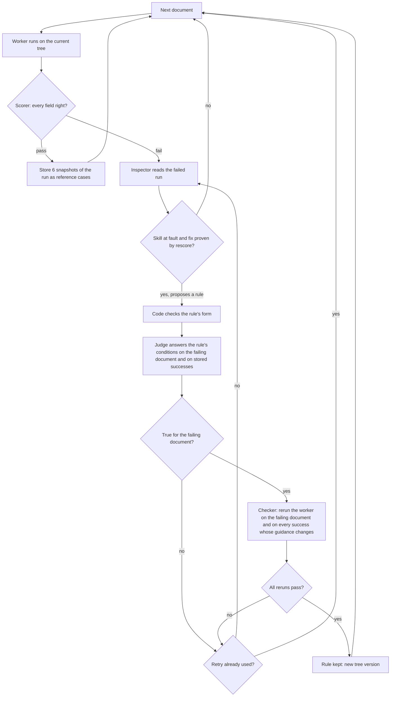
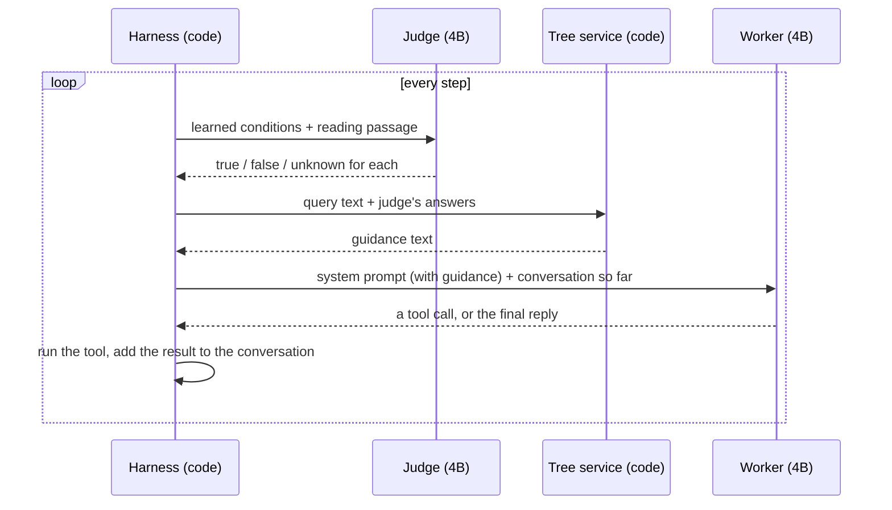
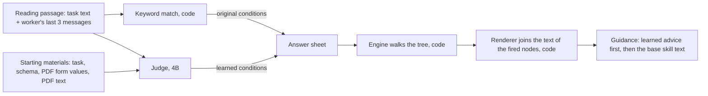

# Pipeline overview: who receives what

One page on how a learning run works: which parts are models, which are plain code, and exactly
what each one is given. For the reasons behind each choice, see
[learning-design-decisions.md](learning-design-decisions.md); the codes in brackets (I3, J4, …) point there.

Values such as step limits are the ones in the current VAREX learning configs.

## 1. The parts

| Part | What it is | Model | Job |
|---|---|---|---|
| Worker | LLM | 4B | Does the task on one document, step by step |
| Judge | LLM | 4B | Answers true / false / unknown on learned conditions |
| Inspector | LLM | 27B | Reads one failed worker run and proposes one rule |
| Checker | **Code**, not a model | (reruns the worker) | Reruns the worker with the proposed rule and scores the result |
| Harness | Code | none | Runs each model's loop, runs its tools, fetches the guidance |
| Tree service and engine | Code | none | Walks the rule tree and builds the guidance text |
| Scorer | Code | none | The benchmark's official pass / fail |

Only code decides whether a rule is kept (I1). No model votes on it.

## 2. One document, start to finish

- Each document is learned from once, on the tree learned so far (T3).
- A rejected rule gets one inspector retry with the reason as feedback (I4).

## 3. The worker

The worker works in a loop. One step is one model call; it asks for a tool call, gets the result, and
decides the next step. The run ends when it replies without a tool call, or after 30 steps (H2).
Each command's output reaches it as at most its first and last 3,000 characters (H1). A run cut off
by its step limit is still scored on the `answer.json` it wrote (H3).

**Two ways to load the guidance** (config `skill_loading`):
- `rolling` (K3): the guidance is rebuilt before every step, as in the diagram below.
- `initial` (K4): the guidance is built once, before step 1, from the task, and kept for the whole run.
  The judge and tree-service calls in the diagram then happen only before the first step.

**What the worker receives at every step**

| Part | Contents | Changes between steps? |
|---|---|---|
| System prompt 1 | The benchmark's instructions | No |
| System prompt 2 (`initial`, H5) | The full skill's "Relevant Skill" section: what skills are, the skill files in the folder, the "Mandatory Skill Usage Protocol" (plus the learned-rules line, K2, when rules fire), and the guidance (section 4) in `<skill_content>`. No `request_skill` tool, no catalog | No |
| System prompt 2–4 (`rolling` only) | Skill instructions (guidance arrives automatically; learned rules are requirements, K2), `<skill_catalog>`, and the guidance in `<active_skill>` | The guidance is rebuilt every step |
| First message | The task sentence, where the PDF and schema files are, where to write `answer.json`, and the output schema | No |
| Conversation | Its own earlier messages and every tool result | Grows each step |
| Tools | `shell` in a working folder holding the PDF, the schema and the skill's extra files (K1) | No |

**Never given to the worker:** the answer key, the score, other attempts, the rules that did not fire.

## 4. How the guidance is built (every step under `rolling`, once under `initial`)

Under `initial`, the reading passage is the task text alone.

- **Answer sheet:** one value per condition, for example `lf_doc_amounts_with_dollar_sign = true`.
- **Tree walk:** starts at the root. A node fires when all its conditions hold; then its children are
  checked. Fired nodes with no fired child supply their text. Several can supply text at once.
- **Guidance text:** a `<learned_rules>` block first, if any learned rule fired, then the base skill
  text (K2). The advice in the block was written by the inspector when the rule was made.
- **Task text stays in the passage** on every step, so what the task sets cannot drop out mid-run (K3).
- **Root-only tree:** the root has no conditions and always fires, so the whole base skill is always
  shown. Every other node is a learned rule with judged conditions only (T5), so the keyword match
  decides nothing there.

## 5. The judge

One call answers a list of conditions. It has no tools except the form it must fill in, and no memory
between calls.

**What the judge receives in one call**

| Part | Contents |
|---|---|
| Instructions | Judge each condition on the visible text only; `unknown` when evidence is missing |
| The conditions | For each: its name, its definition, examples where it is true and where it is false |
| The reading passage | Depends on the condition's scope, below |

| Condition scope | Reading passage | Asked how often |
|---|---|---|
| `document` (for example "has `$` amounts") | Starting materials only: task, output schema, the PDF's filled form values, the PDF's text (first 12,000 characters) | Once per document, then reused (J4) |
| `situation` (about what the worker is doing; older rules only, K4) | The starting materials plus the task text and the worker's last 3 messages | Every worker step under `rolling`; once under `initial` |

Since K4 the inspector no longer chooses the scope: every new condition is `document`.

**When the judge is called**

1. Before worker steps, to fill in the answer sheet (section 4).
2. When a rule is proposed: on the failing document (the answer must be `true`, or the rule is
   rejected, J2), and on stored successes, to find which of them the rule would affect (C2).

**Never given to the judge:** the answer key, the worker's tool outputs, the rule's advice text, the
tree. It does not know which rule a condition belongs to.

An unusable judge answer is asked again, up to 3 times, and is never counted as a verdict (J3).

## 6. The inspector

One inspection covers one failed worker run. Limits: 30 model calls and 30 minutes, with one warning
near the end (I7).

**In its first message**

| Item | Contents |
|---|---|
| Instructions | The workflow: find the error, trace it, prove a fix, decide whether the skill is at fault, propose one rule |
| The failed run | Document ID, task text, the worker's final answer, the verdict, the number of steps |
| Scored comparison | The worker's answer against the answer key, wrong fields only |
| Answer key | The gold answer |
| Guidance history | For each worker step: the answer sheet, the nodes that fired, the text pieces shown |
| The tree | Every node with its conditions and text pieces, and the list of conditions |
| The judge's text | The document's starting materials exactly as the judge reads them for a condition (I10) |
| Base skill | The original skill text, all pieces in order (I12) |
| Root's past successes | On a root-only tree, up to 6 successes for node 0 (I12) |
| Retry feedback | Only on a retry: why the last proposal was rejected, with excerpts of the documents involved (I4). A retry continues the first inspection's conversation, with the feedback as a new message, when it fits (I13) |

**Tools it can call afterwards**

| Tool | Gives |
|---|---|
| `read_trace` | The worker's transcript, up to 10 steps at a time |
| `show_fragment` | The text of one piece of the skill or one learned advice |
| `inspect_shell` | A shell on a fresh copy of the document's input files |
| `rescore` | The official score of a corrected answer it builds. A rule is only tried if one rescore passes (I2) |
| `passing_examples` | Up to 6 past successes for its target node (below) |
| `test_conditions` | The judge's verdict and a one-line reason for up to 4 draft conditions on the failing document; at most 5 tests (I11) |
| `submit_diagnosis` | Its result: the cause, the evidence, and one rule or none. Advice longer than 600 characters is refused for shortening (I14) |

**Past successes (I3).** For the node it wants to change, the inspector can read up to 6 verified
successes in which that node supplied guidance: the most recent ones, never the failing document.
Each shows the task, the passage the judge read, the guidance shown and a short excerpt of the run.
Its instructions say to use them to make its condition narrow enough to leave those successes alone.
It cannot test a draft condition against them itself; that check happens after it submits, and a
rule that is too broad comes back as retry feedback naming the documents it also matched. It can
test a draft condition on the failing document with `test_conditions` (I11).

**What it submits.** A cause (`skill_missing`, `skill_misleading`, `not_skill`, `answer_key_error`,
`unexplained`) and, for the first two, one rule: target node, conditions, advice text. A new
condition has a name, a definition, examples and counterexamples. It must be a property of the
starting materials, since the judge reads nothing else (K4).

**On a root-only tree (T5):** the original skill's conditions are hidden from the guidance history
and the tree, and a rule that uses one is refused at submit time.

**Never given to the inspector:** the power to change the tree. Code checks the form of the rule
(I6), the judge answers its conditions, and the checker reruns the worker.

## 7. The checker

The checker is code. It does not read or reason; it reruns the worker and reads the score.

| Step | What happens |
|---|---|
| 1 | The proposed rule is added to a copy of the tree (the candidate tree) |
| 2 | Code lists the documents to rerun: the failing document, plus every stored success whose guidance the rule would change (C2) |
| 3 | The worker is run once on each (C4), exactly as in section 3, with guidance from the candidate tree |
| 4 | The official scorer marks each rerun |
| 5 | The rule is kept only if the failing document now passes and every rerun success still passes (C1) |

- A rerun worker receives the same things as any worker run. The only difference is the tree.
- After a rule is kept, the stored snapshots of the rerun successes are replaced by the new runs (C3).

## 8. Who can see the answer key

| Part | Sees the answer key? |
|---|---|
| Worker | No |
| Judge | No |
| Inspector | Yes: it needs it to find the error and to prove its fix |
| Checker | Only through the scorer's pass / fail |
| Guidance shown to the worker | No. The inspector is told to write general advice, never this document's values |
